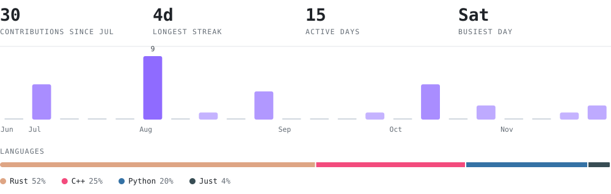

<!-- Generated by scripts/build.mjs from profile.config.mjs. Edit those; this file is overwritten. -->

<picture><source media="(prefers-color-scheme: dark)" srcset="assets/hero-dark.svg"></picture>

 

<picture><source media="(prefers-color-scheme: dark)" srcset="assets/activity-dark.svg"></picture>

Updated daily from public GitHub activity. &nbsp;·&nbsp; <a href="https://x.com/Sablerite">X / Twitter</a>

