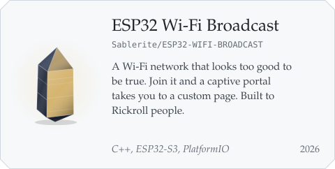
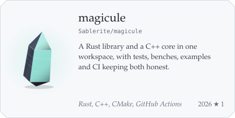
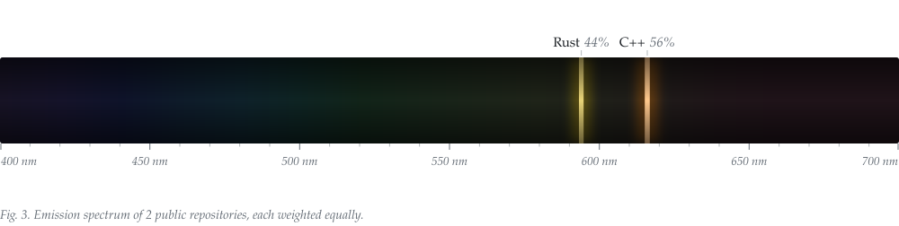
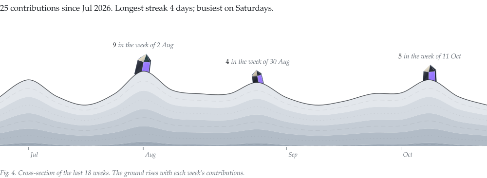

<!-- Generated by scripts/build.mjs from profile.config.mjs. Edit those; this file is overwritten. -->

<picture><source media="(prefers-color-scheme: dark)" srcset="assets/hero-dark.svg"></picture>

Rust, C++, and firmware for small boards. I build things to find out how they work, and keep the ones that teach me something.

### Specimen data

<picture><source media="(prefers-color-scheme: dark)" srcset="assets/specimen-dark.svg"></picture>

### In the collection

<a href="https://github.com/Sablerite/ESP32-WIFI-BROADCAST"><picture><source media="(prefers-color-scheme: dark)" srcset="assets/card-esp32-wi-fi-broadcast-dark.svg"></picture></a>
<a href="https://github.com/Sablerite/magicule"><picture><source media="(prefers-color-scheme: dark)" srcset="assets/card-magicule-dark.svg"></picture></a>

### Assay

<picture><source media="(prefers-color-scheme: dark)" srcset="assets/spectrum-dark.svg"></picture>

<picture><source media="(prefers-color-scheme: dark)" srcset="assets/strata-dark.svg"></picture>

The spectrum and the cross-section regrow every day from public activity on [@Sablerite](https://github.com/Sablerite).

 

[@Sablerite on X](https://x.com/Sablerite)

<em>Handle with curiosity.</em>

